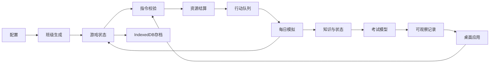

# 核心系统架构

## 数据流

## 模块职责

| 目录 / 文件 | 职责 |
| --- | --- |
| `src/config/game.ts` | 学科与知识树、考试日、行动成本、难度、事件、姓名 |
| `src/config/desktop.ts` | 游戏名称、2011日期和应用对应的历史软件类型 |
| `src/sim/types.ts` | 真实学生、知识、观察、指令、事件、考试、轨迹契约 |
| `src/sim/random.ts` | 种子哈希、可序列化 PRNG、范围与统计函数 |
| `src/sim/generate.ts` | 相关属性、个体知识、关系和摸底班级生成 |
| `src/sim/knowledge.ts` | 学习、熟练度、遗忘与座位影响 |
| `src/sim/ai.ts` | 多因子自主决策、240 分钟预算、状态与班级生态 |
| `src/sim/homework.ts` | 依据真实知识/状态生成作业提交与错误线索 |
| `src/sim/questions.ts` | 知识点对应题目、标准答案和错误模板 |
| `src/sim/exam.ts` | 试卷覆盖与难度、知识评分、有界临场发挥 |
| `src/sim/events.ts` | 条件/概率/冷却触发、选项影响和观察积累 |
| `src/sim/engine.ts` | 唯一模拟指令入口，事务式校验、扣费和回合推进 |
| `src/sim/analytics.ts` | 只基于已观察成绩的预测、统计与报告导出 |
| `src/sim/save.ts` | 存档格式、校验、版本与结构验证 |
| `src/sim/strategies.ts` | 不读取隐藏属性的可重复策略基线 |
| `src/state/storage.ts` | IndexedDB、串行写队列、手动槽和排行榜 |
| `src/state/store.ts` | Zustand 统一状态，窗口间同步 |
| `src/ui/` | 窗口管理、业务交互、图表、设置与隔离调试 |

界面外壳由`Desktop`管理XP窗口、任务栏与开始菜单，`ClassicFrame`提供按软件类型组织的菜单/工具栏，`FileExplorer`提供真实应用文件入口，`ClassicChat`提供QQ式规则沟通。`legacy.css`统一历史界面，基础业务布局复用`styles.css`。Excel数据菜单通过类型化`SheetCommand`更新同一个成绩视图。

主题、背景、快捷方式回收站与最近文档使用独立的`gamex-2011-*`本地偏好键，不进入学生模拟状态。存档结构与数据库名称保持兼容，游戏日历通过2011年日期映射显示，旧种子不会被修改。

## 真实、观察与推测

`Student` 保存真实能力、习惯、心理、家庭、关系和各知识点。`Observation` 标记课堂、作答、学生、家长等来源；`教师推测` 独立标记且不等于真实原因。

普通界面可以查看考试与作答，但不展示 `actualCause`、诊断匹配、真实掌握度或底层心理数值。成绩预测只读历史考试，不调用模拟器预演未来。集体环境以粗分段展示。

诊断匹配只有在后续 `feedback` 教学计算中作为效率因子使用。错误判断本身不改变学生行为动机。调试实验室通过 `structuredClone` 建立 `debug: true` 副本，存储层和排行构造函数均拒绝调试数据。

## 每日学习预算

学生一天共享 240 分钟。支持性活动先占用时间，作业按真实完成量计时，剩余时间在六科基础课程与已排教学中按需求比例分配；剩余时间由自律、动力、复习倾向、疲劳、拖延和信任决定自主投入，其余记为休整。

每人生成一条 `StudyLedger`：授课、作业、自学、休整之和等于预算，按科目的时间之和等于实际学习时间。没有重复使用分钟。额外单科需求会压缩所有基础课程。日初邻座快照避免结算顺序给后续学生引入优势。

## 知识、遗忘与分数

学习增量由分钟、能力、注意/动力/疲劳/压力、座位、生态、方式、知识难度共同决定，并乘以 `(1-掌握度)^1.45` 与熟练度递减因子。复习增加熟练度；长期不练的知识按遗忘倾向与记忆能力衰减。

考试按试卷覆盖加权知识和熟练度，经过 `知识^0.86 × 难度因子 × 状态因子 + 有界临场波动`，裁剪到分科满分并保留一位小数。总分从分科相加生成。学生没有可供行为直接修改的“真实成绩”字段。

## 确定性与保存

模拟核心不使用 `Math.random()`、系统时钟或外部 I/O。所有随机调用由保存了状态的 PRNG 完成；学生活动、试卷、作业、事件均顺序使用同一个随机状态。

`execute` 克隆输入，完整验证后才扣费；失败返回原对象且不推进随机状态。保存包含行动队列、真实状态、观察、事件冷却和 PRNG。检查和哈希用于发现意外损坏，不承担防篡改认证。

IndexedDB 写入串行排队，防止快速推进时旧存档覆盖新存档。写失败必须提示，不能假装保存成功。局内状态不依赖异步写盘结果，导出文件可用于独立备份。正常轨迹保留最近七日的详细计算，完整行动/考试/观察保留整局；调试副本保留其调试期间的全部轨迹。

## 配置扩展边界

开局通过`GameSettings.track`选择理科`science`或文科`arts`，之后不在原班级中途切换。`getSubjects(game.settings)`返回本局六科，生成、学习、考试、统计和界面均使用这一入口；`ALL_SUBJECTS`及`SUBJECT_MAP`只用于查找，不能将九科一起加入日常学习。理科为语数外物化生，文科为语数外政史地，均为750分；当前任教限语数外。

存档格式仍为版本1。读取无`track`的旧档时，先验证原始摘要和理科数据，再补齐`science`，保持学生、考试、标识与随机序列。新增其他科类或科目时，需要同步题库、界面、测试与明确迁移，不能让旧档凭空缺失知识或分数。历史排行榜的科类字段可缺省，缺省表示理科。

当前是规则模拟，不调用大模型。代表题用于批改交互，整份卷子的成绩由全知识点加权模型产生，不伪造逐题阅读式智能。家庭沟通以支持、压力和信任建模，不对现实心理诊断做推论。
